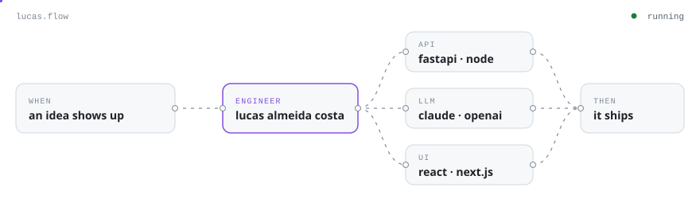
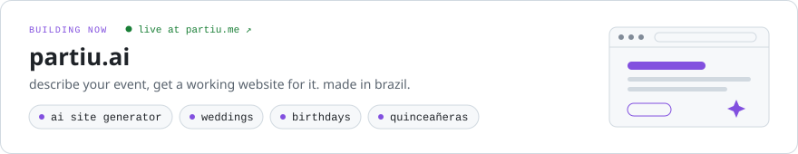
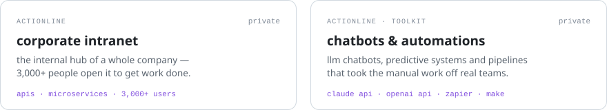

<picture>
  <source media="(prefers-color-scheme: dark)" srcset="assets/hero-dark.svg">
  
</picture>

### hey, i'm lucas.

i build things that take work off people's plates: web products end to end, with llms wired in where they actually help and automations doing the boring part.

by day i'm a full-stack engineer at **toolkit**. the rest of the time i'm building **[partiu.ai](https://partiu.me)**, which turns "we're getting married in march" into a working event website.

- **the whole problem, not a slice of it** — database, api, interface, deploy. i'd rather own the outcome than a ticket.
- **ai as plumbing, not decoration** — chatbots and predictive systems that run in production, for people who never have to know there's a model behind them.
- **if i did it twice, a workflow does it the third time** — my favorite kind of code is the kind that deletes work.

 

### things i've shipped

<a href="https://partiu.me">
<picture>
  <source media="(prefers-color-scheme: dark)" srcset="assets/partiu-dark.svg">
  
</picture>
</a>

<picture>
  <source media="(prefers-color-scheme: dark)" srcset="assets/work-dark.svg">
  
</picture>

the good stuff sits in private repos — if you're curious, ask and i'll show you around.

 

### what i reach for

<picture>
  <source media="(prefers-color-scheme: dark)" srcset="assets/stack-dark.svg">
  
</picture>

 

### say hi

<a href="https://lucasac.tech"><picture><source media="(prefers-color-scheme: dark)" srcset="assets/hi-site-dark.svg"></picture></a>
<a href="https://www.linkedin.com/in/lucas-ac/"><picture><source media="(prefers-color-scheme: dark)" srcset="assets/hi-linkedin-dark.svg"></picture></a>
<a href="mailto:lucasac.contato@outlook.com"><picture><source media="(prefers-color-scheme: dark)" srcset="assets/hi-email-dark.svg"></picture></a>

são paulo, brasil · português, english, un poco de español
